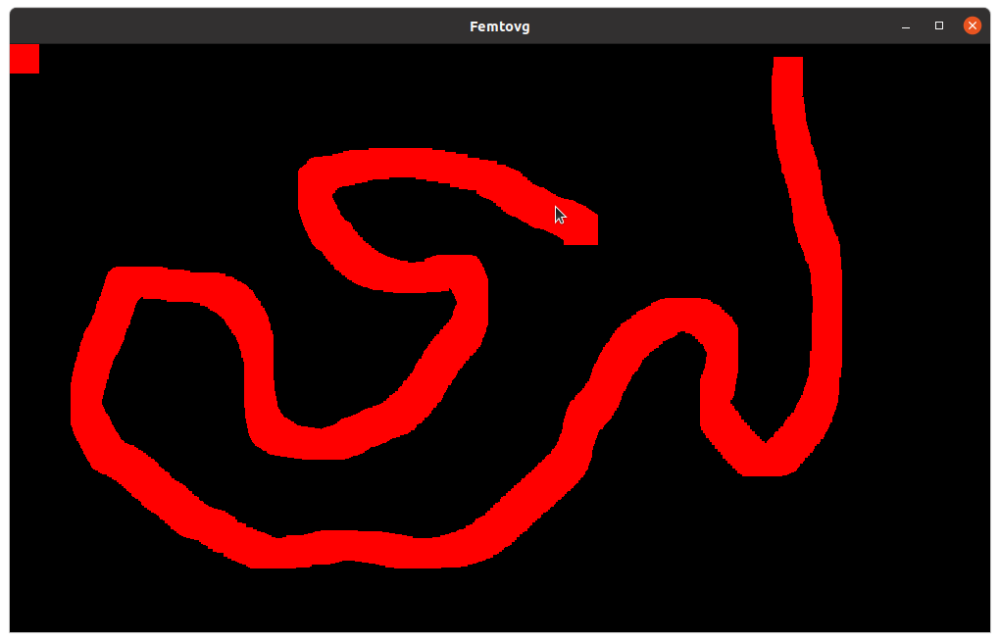
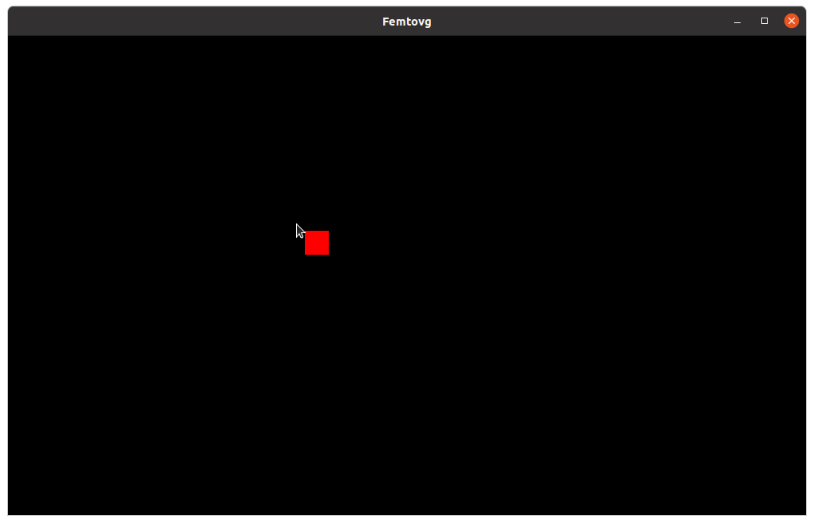

# The Event Loop

So far, our app isn't really "doing" anything – in fact, it won't even respond if we try to close it with the "x" button. To handle input from the user, we must use the event loop.

winit delivers each event to our `App` by calling a method of `ApplicationHandler`. Events that concern a window go to `window_event`; let's print them:

```rust,ignore
impl ApplicationHandler for App {
    fn resumed(&mut self, event_loop: &ActiveEventLoop) {
        // [...] create the window, renderer and canvas, as before
    }

    fn window_event(&mut self, event_loop: &ActiveEventLoop, window_id: WindowId, event: WindowEvent) {
        println!("{:?}", event);
    }
}
```

[`event_loop.run_app`](https://docs.rs/winit/0.30/winit/event_loop/struct.EventLoop.html#method.run_app) calls the application's methods for each new event, until the program exits.

[`window_event`](https://docs.rs/winit/0.30/winit/application/trait.ApplicationHandler.html#tymethod.window_event) is the one we are most interested in. It receives:
- A [`WindowId`](https://docs.rs/winit/0.30/winit/window/struct.WindowId.html) – but since we only have 1 window in this example, the ID will always match with our window's ID.
- A [`WindowEvent`](https://docs.rs/winit/0.30/winit/event/enum.WindowEvent.html) enum, which contains information about the window event.

You can run the example to see the different types of `WindowEvent`s being printed as you interact with the window! You might see something like:

```
CursorMoved { device_id: DeviceId(X(DeviceId(2))), position: PhysicalPosition { x: 931.1624145507813, y: 270.08074951171875 } }
CursorMoved { device_id: DeviceId(X(DeviceId(2))), position: PhysicalPosition { x: 981.8682861328125, y: 257.404296875 } }
CursorLeft { device_id: DeviceId(X(DeviceId(2))) }
ModifiersChanged(Modifiers { state: ModifiersState(0x0), pressed_mods: ModifiersKeyState(0x0) })
Focused(false)
```

## Exiting on Close
Clicking on the window's close button also creates a `WindowEvent`. We'll capture this event to exit the application when the user requests it:

```rust,ignore
fn window_event(&mut self, event_loop: &ActiveEventLoop, _id: WindowId, event: WindowEvent) {
    match event {
        WindowEvent::CloseRequested => event_loop.exit(),
        _ => {}
    }
}
```

Try running it! The program should exit when you click the close button.

> [`ActiveEventLoop::exit`](https://docs.rs/winit/0.30/winit/event_loop/struct.ActiveEventLoop.html#method.exit) asks the event loop to stop; `run_app` then returns.

## Tracking Mouse Movement

Using the `CursorMoved` event, we can track the mouse position. Let's keep the latest position we know in the app state, and update it whenever we get a `CursorMoved` event:

```rust,ignore
struct AppState {
    // [...] context, surface, window, canvas
    mouse_position: PhysicalPosition<f64>,
}

fn window_event(&mut self, event_loop: &ActiveEventLoop, _id: WindowId, event: WindowEvent) {
    let Some(state) = self.state.as_mut() else {
        return;
    };

    match event {
        WindowEvent::CursorMoved { position, .. } => {
            state.mouse_position = position;
        }
        // ...
    }
}
```

## Re-rendering
So far, our code only renders the window once – after that, there's no rendering, only event handling. But suppose we wanted the red square to follow the mouse. How can we re-render the square in the new position?

We'll need to re-render every time the mouse position changes. The correct way to do this is to [`request_redraw`](https://docs.rs/winit/0.30/winit/window/struct.Window.html#method.request_redraw), so that the platform knows we want to draw some new stuff. Then, we'll receive a `WindowEvent::RedrawRequested` event, and that's when we can render a new frame:

```rust,ignore
match event {
    WindowEvent::CursorMoved { position, .. } => {
        state.mouse_position = position;
        state.window.request_redraw();
    }
    WindowEvent::RedrawRequested => {
        render(&state.context, &state.surface, &state.window, &mut state.canvas, state.mouse_position);
    }
    // ...
}
```

Finally, we should update our `render` function to take the mouse position into account – we can just use those coordinates for the square position:

```rust, ignore
fn render<T: Renderer>(
    context: &PossiblyCurrentContext,
    surface: &Surface<WindowSurface>,
    window: &Window,
    canvas: &mut Canvas<T>,
    square_position: PhysicalPosition<f64>,
) {
    //...
    canvas.clear_rect(
        square_position.x as u32,
        square_position.y as u32,
        30,
        30,
        Color::rgbf(1., 0., 0.),
    );
    //...
}
```

Our code runs! There's just one small problem...



What happened? Since there's no code to "erase" the old square, all the squares pile up on each other, creating a red mess. To fix this, we should clear the entire window before rendering anything new.

```rust,ignore
canvas.clear_rect(0, 0, size.width, size.height, Color::black());
```

Now, if you run the code, the red square will happily follow the cursor wherever it goes.



To recap, here's the code we've written:

```rust,ignore
{{#include 3_event_loop.rs}}
```